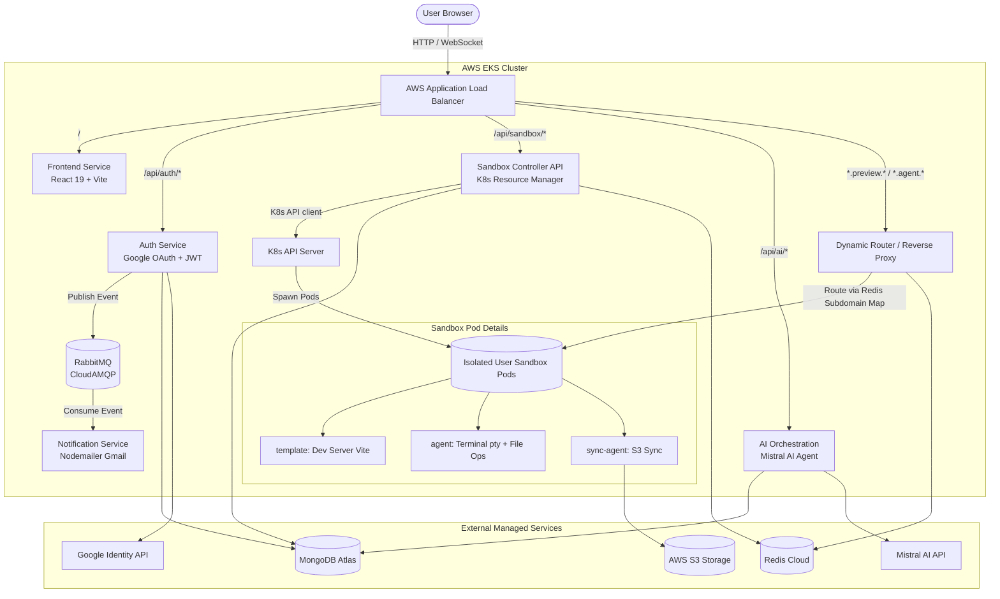

# 🚀 AgentSpace — Cloud-Native AI Sandbox & Web IDE

> 🌐 **Live Production Deployment**: [http://agentspace.54.255.113.123.nip.io](http://agentspace.54.255.113.123.nip.io)  
> 🔗 **Alternative Mirror URL**: [http://agentspace-54-255-113-123.sslip.io](http://agentspace-54-255-113-123.sslip.io)

[](https://kubernetes.io/)
[](https://aws.amazon.com/eks/)
[](https://www.docker.com/)
[](https://react.dev/)
[](https://vitejs.dev/)
[](https://tailwindcss.com/)
[](https://nodejs.org/)
[](https://www.mongodb.com/)
[](https://redis.io/)
[](https://www.rabbitmq.com/)

**AgentSpace** is a production-grade, distributed, cloud-native Web IDE and isolated sandbox runtime platform (similar to GitHub Codespaces, Replit, or CodeSandbox). It dynamically provisions isolated containerized environments on Kubernetes, complete with in-browser terminal access, live interactive previews, bi-directional S3 persistence, and an integrated AI coding assistant.

---

## 📑 Table of Contents

- [Architectural Overview](#-architectural-overview)
- [Microservices Ecosystem](#-microservices-ecosystem)
- [Key Features](#-key-features)
- [Repository Structure](#-repository-structure)
- [Prerequisites](#-prerequisites)
- [Environment Configuration & Secrets](#-environment-configuration--secrets)
- [Google Cloud OAuth 2.0 Setup](#-google-cloud-oauth-20-setup)
- [Local Development Setup](#-local-development-setup)
- [Production Deployment on AWS EKS](#-production-deployment-on-aws-eks)
  - [1. Cluster & Nodegroup Setup](#1-cluster--nodegroup-setup)
  - [2. AWS VPC CNI Prefix Delegation (Critical)](#2-aws-vpc-cni-prefix-delegation-critical)
  - [3. AWS Load Balancer Controller](#3-aws-load-balancer-controller)
  - [4. Container Registry (ECR) Setup](#4-container-registry-ecr-setup)
  - [5. Manifest Deployment & Target Group Health Checks](#5-manifest-deployment--target-group-health-checks)
- [API Reference](#-api-reference)
- [Troubleshooting & FAQs](#-troubleshooting--faqs)

---

## 🏛 Architectural Overview



---

## 🧩 Microservices Ecosystem

| Microservice | Path / Context | Description |
| :--- | :--- | :--- |
| **`frontend`** | [`frontend/`](frontend) | Single-page application built with React 19, Tailwind CSS v4, and `@xterm/xterm`. Includes Google Sign-In, Project Manager, Live Preview, Code Editor, Web Terminal, and AI Chat Assistant. |
| **`auth`** | [`auth/`](auth) | User authentication service. Handles Google OAuth 2.0 flow, JWT generation, HTTP-only cookie management, profile verification (`/api/auth/me`), and logout (`/api/auth/logout`). |
| **`sandbox/server`** | [`sandbox/server/`](sandbox/server) | Core orchestration API. Interacts with the Kubernetes API using ServiceAccount RBAC to dynamically schedule and manage user project pods. |
| **`sandbox/router`** | [`sandbox/router/`](sandbox/router) | Low-latency dynamic reverse proxy. Reads subdomain-to-pod mappings in Redis to route wildcard preview and agent traffic directly to isolated pods. |
| **`sandbox/agent`** | [`sandbox/agent/`](sandbox/agent) | Container sidecar running inside user pods. Exposes WebSocket terminal sessions using `node-pty` and provides file manipulation endpoints. |
| **`sandbox/sync-agent`** | [`sandbox/sync-agent/`](sandbox/sync-agent) | Sidecar container that watches pod workspace files and performs bi-directional synchronization with AWS S3 buckets. |
| **`sandbox/template`** | [`sandbox/template/`](sandbox/template) | Runtime container template providing pre-configured Node.js, npm, Vite, and development tools for user code execution. |
| **`ai-orchestration`** | [`ai-orchestration/`](ai-orchestration) | AI code assistant service powered by Mistral AI. Analyzes project context and applies file changes directly to the running workspace. |
| **`notification`** | [`notification/`](notification) | Asynchronous messaging worker. Consumes authentication and workspace events from RabbitMQ and dispatches transactional emails. |

---

## ✨ Key Features

- **Isolated Runtime Execution**: Every user workspace runs inside a separate, resource-bounded Kubernetes Pod.
- **Google OAuth 2.0 & Session Management**: Secure authentication using signed HTTP-only cookies, automated session hydration, and one-click logout.
- **In-Browser Terminal**: Full interactive terminal experience powered by `xterm.js` and `node-pty` over WebSockets.
- **Live Preview with Subdomain Routing**: Dynamic wildcard DNS routing (`*.preview.<domain>`) allows users to preview running web apps in real-time.
- **AI-Powered Coding**: Integrated Mistral AI assistant that understands project files and generates, modifies, and debugs code.
- **Persistent Storage**: Changes are automatically synced to AWS S3, ensuring workspaces can be shut down and resumed seamlessly.
- **Production-Ready AWS EKS Deployment**: Tuned for AWS Application Load Balancer with custom health checks and high pod density via VPC CNI prefix delegation.

---

## 📂 Repository Structure

```text
.
├── ai-orchestration/          # AI Service (Mistral AI integration)
│   ├── src/
│   │   ├── routes/            # Agent prompt & completion routes
│   │   └── app.js             # Express app & /api/status/healthz
│   └── dockerfile
├── auth/                      # Authentication microservice
│   ├── src/
│   │   ├── config/            # DB & RabbitMQ config
│   │   ├── models/            # Mongoose User model
│   │   ├── routes/            # /google, /callback, /me, /logout
│   │   └── app.js             # Express app, CORS, Passport init
│   └── dockerfile
├── frontend/                  # React 19 + Tailwind v4 Web Client
│   ├── src/
│   │   ├── components/        # SplashScreen, TopBar, Terminal, AiChat, FileViewer
│   │   ├── App.jsx            # State & layout manager
│   │   └── main.jsx
│   ├── vite.config.js         # Allowed hosts and proxy rules
│   └── Dockerfile             # Multi-stage production build & preview server
├── k8s/                       # Kubernetes deployment manifests
│   ├── ai-deployment.yml      # AI service deployment
│   ├── ai-service.yml         # AI ClusterIP service
│   ├── auth-deployment.yml    # Auth deployment
│   ├── auth-service.yml       # Auth ClusterIP service
│   ├── frontend-deployment.yml# Frontend deployment
│   ├── frontend-service.yml   # Frontend ClusterIP service
│   ├── ingress.yml            # AWS ALB Ingress with wildcard subdomain rules
│   ├── notification-deployment.yml
│   ├── notification-service.yml
│   ├── rbac.yml               # ServiceAccount & Role for pod creation
│   ├── router-deployment.yml  # Dynamic proxy deployment
│   ├── router-service.yml     # Dynamic proxy ClusterIP service
│   ├── sandbox-deployment.yml # Sandbox controller deployment
│   ├── sandbox-service.yml    # Sandbox controller ClusterIP service
│   ├── secrets.example.yml    # Template for Kubernetes secrets
│   └── secrets.yml            # (Ignored) Production secrets
├── notification/              # RabbitMQ email consumer
│   ├── src/
│   └── dockerfile
├── sandbox/                   # Sandbox subsystem
│   ├── agent/                 # Terminal and file management sidecar
│   ├── router/                # Subdomain reverse proxy
│   ├── server/                # Sandbox orchestration controller
│   ├── sync-agent/            # AWS S3 file synchronizer
│   └── template/              # Base runtime workspace container
├── skaffold.yml               # Local development Skaffold config
├── skaffold-eks.yaml          # AWS EKS Skaffold build & sync config
└── README.md
```

---

## 🛠 Prerequisites

Ensure you have the following installed locally:

- **[Docker Desktop](https://www.docker.com/products/docker-desktop/)** (with Kubernetes enabled) or **Docker Engine**.
- **[kubectl](https://kubernetes.io/docs/tasks/tools/)** (v1.28+).
- **[Node.js](https://nodejs.org/)** (v20+ or v22+) & `npm`.
- **[AWS CLI](https://aws.amazon.com/cli/)** (v2+) configured with administrative IAM credentials.
- **[eksctl](https://eksctl.io/)** (for AWS EKS provisioning).
- **[Skaffold](https://skaffold.dev/)** (optional, recommended for continuous local dev).

---

## 🔐 Environment Configuration & Secrets

The application expects 5 Kubernetes Secret resources in the target namespace (`default`).

Create a copy of [`k8s/secrets.example.yml`](k8s/secrets.example.yml) as `k8s/secrets.yml`:

```bash
cp k8s/secrets.example.yml k8s/secrets.yml
```

Edit `k8s/secrets.yml` and provide your credentials:

```yaml
apiVersion: v1
kind: Secret
metadata:
  name: database
type: Opaque
stringData:
  AUTH: "mongodb+srv://<user>:<password>@<cluster>.mongodb.net/auth"
  SANDBOX: "mongodb+srv://<user>:<password>@<cluster>.mongodb.net/sandbox"
  AI: "mongodb+srv://<user>:<password>@<cluster>.mongodb.net/ai"
  REDIS_URL: "redis://default:<password>@<host>:<port>"
  RABBITMQ_URL: "amqps://<user>:<password>@<host>/<vhost>"

---
apiVersion: v1
kind: Secret
metadata:
  name: jwt
type: Opaque
stringData:
  JWT_SECRET: "your-strong-random-32-byte-secret"

---
apiVersion: v1
kind: Secret
metadata:
  name: google
type: Opaque
stringData:
  GOOGLE_CLIENT_ID: "your-client-id.apps.googleusercontent.com"
  GOOGLE_CLIENT_SECRET: "your-client-secret"
  GOOGLE_REFRESH_TOKEN: "your-oauth-refresh-token"
  EMAIL_USER: "your-sender-email@gmail.com"

---
apiVersion: v1
kind: Secret
metadata:
  name: ai-secret
type: Opaque
stringData:
  MISTRAL_API_KEY: "your-mistral-api-key"

---
apiVersion: v1
kind: Secret
metadata:
  name: aws
type: Opaque
stringData:
  AWS_REGION: "ap-southeast-1"
  AWS_ACCESS_KEY_ID: "your-aws-access-key-id"
  AWS_SECRET_ACCESS_KEY: "your-aws-secret-access-key"
```

Apply the secrets to the cluster:

```bash
kubectl apply -f k8s/secrets.yml
```

---

## 🔑 Google Cloud OAuth 2.0 Setup

1. Open the **[Google Cloud Console Credentials Page](https://console.cloud.google.com/apis/credentials)**.
2. Select your project and click **Create Credentials > OAuth client ID** (Application type: *Web application*).
3. In **Authorized JavaScript origins**, add both local and deployed domains:
   - `http://localhost:5173`
   - `http://agentspace.54.255.113.123.nip.io` *(replace with your deployed domain or IP)*
4. In **Authorized redirect URIs**, add:
   - `http://localhost:5173/api/auth/google/callback`
   - `http://agentspace.54.255.113.123.nip.io/api/auth/google/callback`
5. Save your changes. Store the **Client ID** and **Client Secret** in `k8s/secrets.yml`.

> [!IMPORTANT]
> If you encounter `Error 400: redirect_uri_mismatch`, ensure the redirect URI in Google Cloud Console matches the exact scheme, host, and path requested by the browser.

---

## 💻 Local Development Setup

### Option 1: Running with Skaffold & Docker Desktop (Recommended)

1. Enable Kubernetes inside **Docker Desktop > Settings > Kubernetes > Enable Kubernetes**.
2. Apply RBAC and secrets:
   ```bash
   kubectl apply -f k8s/rbac.yml
   kubectl apply -f k8s/secrets.yml
   ```
3. Start all microservices with live reloading:
   ```bash
   skaffold dev
   ```
4. Skaffold will build all local images and automatically forward ports:
   - **Frontend UI**: [http://localhost:5173](http://localhost:5173)
   - **Auth Service**: [http://localhost:3001](http://localhost:3001)
   - **Sandbox API**: [http://localhost:3000](http://localhost:3000)
   - **AI Orchestration**: [http://localhost:3002](http://localhost:3002)

---

## ☁️ Production Deployment on AWS EKS

### 1. Cluster & Nodegroup Setup

Create an Amazon EKS cluster with managed worker nodes using `eksctl`:

```bash
eksctl create cluster \
  --name express-cluster \
  --region ap-southeast-1 \
  --version 1.30 \
  --nodegroup-name express-nodes-s \
  --node-type t3.small \
  --nodes 2 \
  --nodes-min 2 \
  --nodes-max 4 \
  --managed
```

Update your local `kubeconfig`:

```bash
aws eks update-kubeconfig --name express-cluster --region ap-southeast-1
```

---

### 2. AWS VPC CNI Prefix Delegation (Critical)

By default, smaller EC2 instances like `t3.micro` or `t3.small` only support **4 to 11 pods per node** due to elastic network interface (ENI) IP limits. Because each user session creates a dynamic pod, you must enable **Prefix Delegation**:

```bash
# Enable prefix delegation on AWS VPC CNI daemonset
kubectl set env daemonset aws-node -n kube-system ENABLE_PREFIX_DELEGATION=true
kubectl set env daemonset aws-node -n kube-system WARM_PREFIX_TARGET=1

# Restart aws-node pods
kubectl rollout restart daemonset aws-node -n kube-system
```

> [!TIP]
> Enabling prefix delegation increases the pod capacity of a `t3.small` node from **11 pods to 110 pods per node**, allowing hundreds of user sandboxes without exceeding AWS account vCPU limits!

---

### 3. AWS Load Balancer Controller

Install the AWS Load Balancer Controller to manage the Application Load Balancer (ALB) defined in `k8s/ingress.yml`:

```bash
# 1. Associate IAM OIDC Provider
eksctl utils associate-iam-oidc-provider --cluster express-cluster --region ap-southeast-1 --approve

# 2. Create IAM Policy & ServiceAccount
curl -o iam_policy.json https://raw.githubusercontent.com/kubernetes-sigs/aws-load-balancer-controller/main/docs/install/iam_policy.json
aws iam create-policy --policy-name AWSLoadBalancerControllerIAMPolicy --policy-document file://iam_policy.json

eksctl create iamserviceaccount \
  --cluster express-cluster \
  --region ap-southeast-1 \
  --namespace kube-system \
  --name aws-load-balancer-controller \
  --role-name AmazonEKSLoadBalancerControllerRole \
  --attach-policy-arn arn:aws:iam::<YOUR_ACCOUNT_ID>:policy/AWSLoadBalancerControllerIAMPolicy \
  --approve

# 3. Install controller via Helm
helm repo add eks https://aws.github.io/eks-charts
helm repo update
helm install aws-load-balancer-controller eks/aws-load-balancer-controller \
  -n kube-system \
  --set clusterName=express-cluster \
  --set serviceAccount.create=false \
  --set serviceAccount.name=aws-load-balancer-controller
```

---

### 4. Container Registry (ECR) Setup

1. Create ECR repositories for all container images:
   ```bash
   for repo in frontend auth sandbox agent sync-agent router template ai-orchestration notification; do
     aws ecr create-repository --repository-name $repo --region ap-southeast-1
   done
   ```

2. Authenticate Docker to your Amazon ECR registry:
   ```bash
   aws ecr get-login-password --region ap-southeast-1 | docker login --username AWS --password-stdin <YOUR_ACCOUNT_ID>.dkr.ecr.ap-southeast-1.amazonaws.com
   ```

3. Build and push production images:
   ```bash
   # Build & push frontend
   docker build -t <YOUR_ACCOUNT_ID>.dkr.ecr.ap-southeast-1.amazonaws.com/frontend:latest ./frontend
   docker push <YOUR_ACCOUNT_ID>.dkr.ecr.ap-southeast-1.amazonaws.com/frontend:latest

   # Build & push auth
   docker build -t <YOUR_ACCOUNT_ID>.dkr.ecr.ap-southeast-1.amazonaws.com/auth:latest ./auth
   docker push <YOUR_ACCOUNT_ID>.dkr.ecr.ap-southeast-1.amazonaws.com/auth:latest

   # Build & push sandbox server
   docker build -t <YOUR_ACCOUNT_ID>.dkr.ecr.ap-southeast-1.amazonaws.com/sandbox:latest ./sandbox/server
   docker push <YOUR_ACCOUNT_ID>.dkr.ecr.ap-southeast-1.amazonaws.com/sandbox:latest
   ```

---

### 5. Manifest Deployment & Target Group Health Checks

1. **Deploy RBAC, Secrets, and Services**:
   ```bash
   kubectl apply -f k8s/rbac.yml
   kubectl apply -f k8s/secrets.yml
   kubectl apply -f k8s/auth-service.yml
   kubectl apply -f k8s/sandbox-service.yml
   kubectl apply -f k8s/ai-service.yml
   kubectl apply -f k8s/router-service.yml
   kubectl apply -f k8s/frontend-service.yml
   kubectl apply -f k8s/notification-service.yml
   ```

2. **Deploy Microservices**:
   ```bash
   kubectl apply -f k8s/auth-deployment.yml
   kubectl apply -f k8s/sandbox-deployment.yml
   kubectl apply -f k8s/ai-deployment.yml
   kubectl apply -f k8s/router-deployment.yml
   kubectl apply -f k8s/frontend-deployment.yml
   kubectl apply -f k8s/notification-deployment.yml
   ```

3. **Deploy Ingress (ALB)**:
   ```bash
   kubectl apply -f k8s/ingress.yml
   ```

4. **Verify Target Group Health**:
   AWS ALB requires specific health check paths for backend services. The services define annotations that configure the target groups automatically:
   - `auth-service`: `/_status/healthz`
   - `sandbox-service`: `/_status/healthz`
   - `ai-service`: `/api/status/healthz`
   - `router-service`: `/api/status/healthz`
   - `frontend-service`: `/`

   Verify target group states via AWS CLI:
   ```powershell
   $tgs = aws elbv2 describe-target-groups --region ap-southeast-1 | ConvertFrom-Json
   foreach ($tg in $tgs.TargetGroups) {
       $h = aws elbv2 describe-target-health --target-group-arn $tg.TargetGroupArn --region ap-southeast-1 | ConvertFrom-Json
       [PSCustomObject]@{ TargetGroup = $tg.TargetGroupName; Health = $h.TargetHealthDescriptions[0].TargetHealth.State }
   }
   ```
   *Expected output: All target groups report `healthy`.*

5. **Retrieve Your Live URL**:
   Get the ALB address:
   ```bash
   kubectl get ingress codespace-ingress -o jsonpath="{.status.loadBalancer.ingress[0].hostname}"
   ```
   Access your application using wildcard DNS:
   - **Primary**: `http://agentspace.<ALB_IP>.nip.io`
   - **Alternative**: `http://agentspace-<ALB_IP_DASHES>.sslip.io`

---

## 📡 API Reference

### Auth Service (`/api/auth`)

| Method | Endpoint | Description | Auth Required |
| :--- | :--- | :--- | :--- |
| `GET` | `/api/auth/google` | Initiates Google OAuth 2.0 authentication flow | No |
| `GET` | `/api/auth/google/callback` | Callback URL for Google OAuth verification | No |
| `GET` | `/api/auth/me` | Returns current user profile `{ id, name, email, avatar }` | Yes (JWT) |
| `POST/GET`| `/api/auth/logout` | Clears `token` cookie and invalidates session | No |
| `GET` | `/_status/healthz` | Health check endpoint for ALB target groups | No |

### Sandbox Service (`/api/sandbox`)

| Method | Endpoint | Description | Auth Required |
| :--- | :--- | :--- | :--- |
| `GET` | `/api/sandbox/project` | Lists all projects belonging to the logged-in user | Yes (JWT) |
| `POST`| `/api/sandbox/project` | Creates a new project in MongoDB | Yes (JWT) |
| `POST`| `/api/sandbox/start` | Provisions dynamic pod and returns preview/agent URLs | Yes (JWT) |
| `GET` | `/api/sandbox/health` | Service liveness probe | No |
| `GET` | `/_status/healthz` | ALB readiness probe | No |

### AI Orchestration (`/api/ai`)

| Method | Endpoint | Description | Auth Required |
| :--- | :--- | :--- | :--- |
| `POST`| `/api/ai/chat` | Sends prompt to Mistral AI and receives streamed code edits | Yes (JWT) |
| `GET` | `/api/status/healthz`| ALB readiness probe | No |

### Router / Proxy

| Host Pattern | Route | Target Backend |
| :--- | :--- | :--- |
| `*.preview.<domain>` | `/*` | Forwards to user workspace Vite dev server (port 5173 inside pod) |
| `*.agent.<domain>` | `/*` | Forwards to user workspace agent (WebSockets terminal & file API) |

---

## ❓ Troubleshooting & FAQs

### 1. `Error 400: redirect_uri_mismatch` on Google Login
- **Cause**: The redirect URI passed by the auth service does not match the URI in Google Cloud Console.
- **Solution**: Go to Google Cloud Console > Credentials, open your Web OAuth Client, and add:
  `http://<your-domain>/api/auth/google/callback` to **Authorized redirect URIs**.

### 2. Pods stuck in `Pending` with `Too many pods`
- **Cause**: Standard AWS EC2 instances have strict per-ENI IP limits (e.g. `t3.micro` only allows 4 pods).
- **Solution**: Enable VPC CNI Prefix Delegation:
  ```bash
  kubectl set env daemonset aws-node -n kube-system ENABLE_PREFIX_DELEGATION=true
  ```

### 3. ALB returns `502 Bad Gateway` on `/api/auth` or `/api/sandbox`
- **Cause**: Target group default health check (`/`) fails because the backend only handles specific sub-paths.
- **Solution**: Ensure your Service YAML contains:
  ```yaml
  metadata:
    annotations:
      alb.ingress.kubernetes.io/healthcheck-path: /_status/healthz
  ```

### 4. Vite Dev Server Shows `403 Forbidden` / Blocked Host Header
- **Cause**: Vite 8 includes host header protection against DNS rebinding.
- **Solution**: In `frontend/vite.config.js`, configure `allowedHosts: true`:
  ```javascript
  server: {
    allowedHosts: true,
  },
  preview: {
    allowedHosts: true,
  }
  ```

---

## 📄 License

This project is open-source under the [MIT License](LICENSE).
